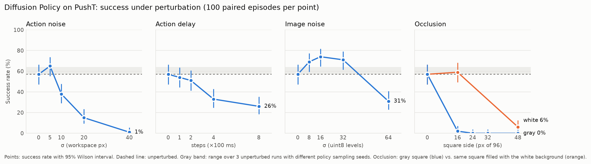
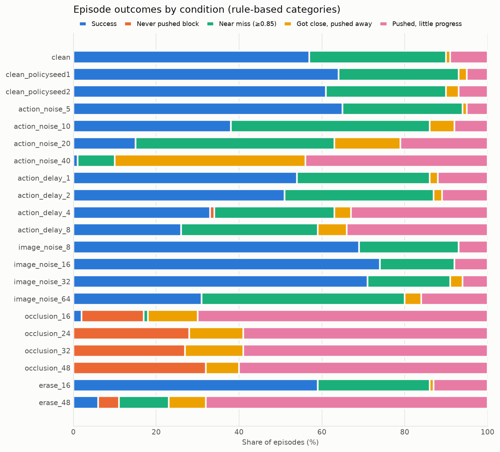

# PushT 策略鲁棒性评测

本项目对 LeRobot 官方 Diffusion Policy 在 PushT 仿真推物任务上做**可复现、配对设计**的鲁棒性评测，分四步：

1. **校验评测流程**：用官方基准确认流程本身可信。
2. **施加扰动**：4 类扰动，每类 4 档强度，每个条件在同一组 100 个初始状态上运行。
3. **加入对照**：用对照组区分"扰动的效果"和"策略自身的随机性"。
4. **人工复核**：根据逐步轨迹给每个回合自动归类结局，再抽样做人工盲审，检验自动分类是否可靠。

> 本仓库只评测已有的预训练策略，不训练模型，也不修改 LeRobot 源码。PushT 是平面推物仿真，结论不外推到机械臂抓取或真实机器人。



## 主要发现

| # | 发现 | 证据 |
| --- | --- | --- |
| 1 | **评测流程可信**：用官方权重复测，结果与公开基准一致 | 50 回合平均最高奖励 0.952（官方 0.955）；成功率 54%，95% 区间 40–67%，覆盖官方的 65.4% |
| 2 | **策略对颜色接近 T 的干扰物极其敏感**：一块不到画面 3% 的灰色方块，就让成功率从 57% 降到 2% | 同样大小、同样位置的方块改成白色背景色后，成功率为 59%（与无扰动相比 p=0.83）。轨迹显示，在 88/100 个回合里，推杆比无扰动时更靠近灰色方块（中位距离 206 → 122 px），离 T 更远（90 → 154 px） |
| 3 | **执行延迟达到 400 ms 时成功率明显下降**，200 ms 以内影响不显著 | 400 ms：57% → 33%，Holm 校正后 p=0.003；800 ms：26%；100–200 ms：54%、51%，均不显著 |
| 4 | **动作噪声 σ≥20 px 时成功率大幅下降**，失败方式也随之改变 | σ=20：15%；σ=40：1%（校正后均 p<0.001）。失败从"接近但未达阈值"转为"推偏"和"推动但进展不足" |
| 5 | **图像噪声 σ≤32 时没有观察到下降**，σ=64 时明显下降 | σ=8–32：69–74%，略高于无扰动重复运行的 57–64%，但校正后不显著（p≥0.076），不能视为提升；σ=64：31%，校正后 p=0.002 |
| 6 | **策略本身的随机性很大**：同一初始状态的成败在重复运行中经常翻转 | 只改变采样随机种子，三次无扰动运行的成功率分别为 57%、64%、61%；两两之间有 33–46 个回合成败翻转；59/100 个初始状态在三次运行中时成时败。因此 100 回合只能稳定地检测出约 15 个百分点以上的差异 |
| 7 | **无扰动时的失败大多是"差一点"** | 43 个失败回合中，有 33 个的最高覆盖率在 0.85–0.95 之间，主要短板是最后的精细对齐 |

完整数字（成功率、Wilson 区间、McNemar 检验和 Holm 校正、配对 bootstrap 区间）见 [results/sweep_summary.md](results/sweep_summary.md)，逐回合数据见 `results/episodes.csv`。

### 结局分类与人工复核



自动分类规则的阈值在跑扫描之前就已固定，共 5 类。从 21 个条件中分层抽取 40 个回合做盲审，结果如下：

| | 一致率 | Cohen's κ |
| --- | ---: | ---: |
| 预先设定的 5 类 | 52.5%（21/40） | 0.41 |
| 事后合并为 3 类（成功 / 未推动 / 部分进展） | 90%（36/40） | 0.82 |

- **定义客观的两类一致性高**："成功"（由环境判定）8 个中人工认出 6 个；"未推动物块"8/8 全部一致。
- **三个"部分进展"子类与人的判断不一致**：
  - 规则把峰值覆盖率 0.40 就算作"接近目标"，但人看画面时并不觉得这算接近。因此规则判为"接近后推离"的 8 个回合，有 7 个被人工标成"推动但进展不足"。
  - 一个回合如果覆盖率曾到 0.85 以上、后来又被推开，规则会先判成"接近但未达阈值"，人则倾向于看成"推离"。
- **因此，本文的结论只用到"成功 / 未推动 / 部分进展"这一级的区分**，图中三个部分进展子类仅作描述，未经人工验证。3 类合并是在看到抽样结果之后才决定的，属于事后分析。要修改规则，需要在一批新抽样上重新验证。详见 [docs/failure_taxonomy.md](docs/failure_taxonomy.md)。

## 过程中发现并修复的问题

下面每一项都有对应的原始数据或测试，具体记录见 [docs/validation.md](docs/validation.md) 和 [docs/history.md](docs/history.md)。

1. **早期低分来自所选权重**。最初用的第三方 Diffusion 权重只训练了 1000 步（官方为 20 万步），评测流程本身没有问题。
2. **LeRobot 0.6.1 迁移旧格式权重时报错**。原因是 `crop_shape` 从 JSON 读进来是列表，而配置要求元组，保存时序列化失败。修复后迁移出的权重与原权重逐元素一致。
3. **原生评测在同一种子下结果不可重复**（两次分别为 0.614 和 0.392）。原因是 cuDNN benchmark，开启确定性设置后修复。
4. **可重复性检查的判定写得过严**。批量运行时，两次结果只在 float64 奖励的最后一位不同（约 1e-16），轨迹逐位一致。判定改为：轨迹逐位一致，奖励差不超过 1e-9。批量并行带来 **11.5 倍**提速（每回合 50.2 s → 4.35 s）。
5. **遮挡实验的设计需要拆开**。灰色方块同时带来"挡住信息"和"出现干扰物"两种效果，为此补做了白色方块对照，并补做策略重新采样的对照来量化随机波动。
6. **回放视频的渲染有 bug，是在人工复核中发现的**。gym-pusht 设置状态时先设位置、后设角度，导致回放里的 T 位置和朝向都画错了。第一轮复核里，环境判为成功的 8 个回合，人工只认出 1 个，由此发现了问题。修复后增加了"回放与实时渲染逐帧比对"的回归测试，第一轮结果作废并存档在 `results/review_v1_misrendered/`。

## 方法要点

- **配对设计**：所有条件都使用同一组 100 个初始状态（种子 2000–2099）。扰动的随机数只由"回合种子 + 扰动类型"决定。策略自身的采样随机性不参与配对，它带来的波动由重新采样对照来衡量。
- **统计方法**：成功率给出 Wilson 区间。与无扰动条件比较时，用精确 McNemar 检验，并对 18 个扰动条件做 Holm 校正；重新采样对照不计入校正。平均最高奖励的差值给出配对 bootstrap 区间。
- **不改动 LeRobot**：策略加载、rollout、成功判定和视频录制全部由 LeRobot 0.6.1 完成，本仓库只是在每个子环境外面包了记录层和扰动层。不加扰动时，结果与原生 LeRobot 逐回合完全相同。
- **数据交叉核对**：每个回合轨迹里的最高奖励和成功标志，都要和 LeRobot 的 `eval_info.json` 逐一核对，全部一致才进入统计。
- **事先固定与事后补充分开标注**：主扫描的扰动档位和分类阈值都在运行前确定（`configs/sweep_b.json`）；看到结果后才加入的对照单独放在 `configs/controls.json`，并在报告中标明。

详细协议见 [docs/protocol.md](docs/protocol.md)。

## 运行

需要 WSL2 或 Linux 系统、一块 NVIDIA GPU，以及 LeRobot 0.6.1 环境。在 RTX 4060 Laptop 上，全部 21 个条件约需 2.5 小时。

```bash
conda activate lerobot
pip install matplotlib pytest                          # LeRobot 环境之外只需这两个
pytest                                                 # 25 个单元测试，约 5 秒
bash scripts/run_all.sh                                # 权重迁移 → 可重复性检查 → 主扫描 → 分析 → 复核抽样
CONFIG=configs/controls.json bash scripts/run_all.sh   # 事后对照
python scripts/review_agreement.py                     # 标注完 results/review/review_sheet.csv 后运行
```

所有步骤都支持断点续跑。原始输出（LeRobot 视频、逐回合轨迹）写在 `$OUT_ROOT`（默认为 `~/pusht_eval_outputs`），汇总结果写进本仓库的 `results/`。

## 仓库结构

```
src/pusht_eval/
  run.py                    入口：确定性设置 + 包装 LeRobot 环境 + 写运行清单
  perturbations.py          动作噪声 / 执行延迟 / 图像噪声 / 遮挡 / 擦除（每回合独立播种）
  trajectory.py             逐步记录推杆位置、物块位姿、覆盖率和动作
  failures.py               回合指标和 5 类结局规则
  analysis.py               读取结果、与 eval_info 交叉核对、与无扰动条件配对比较
  stats.py                  Wilson 区间、精确 McNemar 检验、Holm 校正、bootstrap
  review.py                 回放渲染、盲审抽样、Cohen's κ
  plots.py                  README 中的图
  migrate_legacy_policy.py  修复 LeRobot 0.6.1 迁移旧格式权重的 bug
configs/                    主扫描配置（sweep_b.json）和事后对照配置（controls.json）
results/sweep/              每个条件的 eval_info、运行清单和逐步轨迹
results/review/             第二轮盲审（视频、标注、一致率）
results/review_v1_misrendered/  第一轮盲审（因渲染 bug 作废，存档）
results/validation/         官方权重的 50 回合校验结果
results/archive/            早期第三方权重的实验结果（原样保存）
docs/                       协议、校验、结局分类、项目过程记录、简历表述
```

## 第三方资源

- 策略权重：[`lerobot/diffusion_pusht`](https://huggingface.co/lerobot/diffusion_pusht)（Apache-2.0）。
- 依赖：[LeRobot](https://github.com/huggingface/lerobot)、[gym-pusht](https://github.com/huggingface/gym-pusht)。
- 项目代码在 AI 编程工具的协助下完成。实验设计、运行和结论核对由作者负责。
